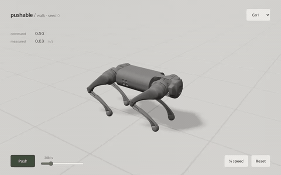

# pushable

Walking robots you can shove, live in your browser. I trained the policies with reinforcement learning on one cloud GPU: 13 minutes and about $0.24 for the dog. The page runs them in the WebAssembly build of MuJoCo, the same physics engine I evaluate them in, and on recorded rollouts its policy actions match my Python reference to within [5×10⁻⁷](results/parity-checks/wasm.json).

**[Try it →](https://mottopanikeiku.github.io/pushable/)** Steer with WASD or the touch pad, drag any body to pull it, press **Push** to shove. Switch between the dog trained with and without shoves and feel the difference.



<!-- generated:headline:start -->
**Does training with random shoves make the dog harder to knock over?** Yes. The shove it survives half the time (J50) rises from 22.7–26.8 N·s to 31.3–35.8 N·s: **+8.8 N·s, 95% interval +4.6 to +13.1**, three seeds per arm. [Comparison](results/report/ablation.csv)
<!-- generated:headline:end -->

Tasks, rewards and PPO settings are from [MuJoCo Playground](https://github.com/google-deepmind/mujoco_playground/tree/d59156e099a8785dd58fbce2e25a6ee1f7b5800c); robot models from [MuJoCo Menagerie](https://github.com/google-deepmind/mujoco_menagerie/tree/1b86ece576591213e2b666ebf59508454200ca97) (licenses in [assets](assets/)); training uses [Brax](https://github.com/google/brax/tree/v0.14.2) PPO. I trained and evaluated the policies, ran the push experiment and wrote the browser runtime.

## What I built

- **Browser runtime** ([physics](web/src/physics.ts), [policy](web/src/policy.ts), [recovery](web/src/recovery.ts)): loads the exact training models and policy weights, builds observations the way training did, and hands a fallen dog to the get-up policy and back. A [parity test](web/test/parity.test.ts) replays recorded rollouts in the browser engine.
- **Reference controller** ([eval/sim.py](eval/sim.py)): observations, policy and control in NumPy and MuJoCo, matched against Playground's own environment to about 10⁻⁶.
- **Evaluation** ([eval/run.py](eval/run.py), [eval/report.py](eval/report.py)): velocity tracking, push recovery and get-up in standard MuJoCo, with every raw trial committed. [Protocol](docs/evaluation.md).
- **Training** ([train/app.py](train/app.py)): Playground and Brax PPO on MJX, run on [Modal](https://modal.com), with exported checkpoints and a manifest per run.

## Results

All numbers are from standard MuJoCo 3.15 with deterministic actions, no observation noise and no domain randomization. [Protocol](docs/evaluation.md).

Survival means no tilt above 60° and no non-foot floor contact, including before and during the 0.1 s shove and for 3 s afterward. Numerical errors also count as failures.

<!-- generated:results:start -->
| Policy | Seeds | Shove survived half the time, J50 (N·s), by seed | Tracking error: forward, lateral (m/s), turning (rad/s) |
|---|---:|---|---|
| Go1, trained without shoves | 3 | 26.8 / 23.4 / 22.7 | 0.068 / 0.058 / 0.057 |
| Go1, trained with shoves | 3 | 31.3 / 31.4 / 35.8 | 0.072 / 0.058 / 0.061 |
| G1 humanoid | 3 | 66.1 / 70.5 / 70.0 | 0.086 / 0.148 / 0.417 |

[Per-seed tracking](results/report/tracking.csv) · [J50 by seed](results/report/j50_seeds.csv) · [survival curves](results/report/push_seeds.svg) · [raw trials](results/eval/)

**Getting up.** From fallen starts, two of the three get-up seeds recover in every trial (181/181 and 179/179); the third almost never does (3/187). Median time back on its feet: 2.1 s. Counting drops where the dog happened to land upright, the totals are 200/200, 199/200 and 16/200. [Per seed](results/report/getup.csv)

**Training simulator vs MuJoCo.** For one dog seed, tracking error differs by at most 0.003 between MJX (Warp), where it trained, and standard MuJoCo; J50 is 30.0 vs 28.3 N·s over 220 matched shove trials. [Comparison](results/report/gap.csv)
<!-- generated:results:end -->

## Reproduce

```bash
uv run python -m eval.report results/eval --output results/report --update-readme   # every number above, from raw trials
cd web && npm ci && npm run dev                                                    # the demo, locally
uv run python train/launch.py train --env Go1JoystickFlatTerrain --seed 0 --gpu L4 --minutes 25   # retrain on Modal
```

<!-- generated:cost:start -->
Each run used one NVIDIA L4 on Modal: 12–14 minutes and $0.22–0.25 per dog walking policy, about 15 minutes and $0.27–0.28 per get-up policy, and 45–49 minutes and $0.79–0.86 per humanoid. The 12 published policies cost $4.69 together; every cloud job, including failed and superseded ones, $9.62. Costs are upper bounds from wall time and list prices. [Runs](results/report/training.csv) · [all jobs](results/report/invocations.csv)
<!-- generated:cost:end -->

## Limits

- Simulation only; nothing here ran on a real robot.
- The walking models simulate only foot contacts, as in Playground, so a fall is judged by tilt rather than by the body hitting the ground.
- One of three get-up seeds never learned to get up; I report it rather than retrain it.
- The humanoid tracks turning commands poorly. Its seed 0 stopped at 181M of 200M planned steps on a time limit (seeds 1 and 2 finished), and the demo uses that checkpoint.
- Demo policies were fixed in advance (seed 0 of each policy), not picked by results.

## Prior work

- Zakka et al., [MuJoCo Playground](https://arxiv.org/abs/2502.08844) (2025): the tasks, rewards and training settings; their Go1 and G1 policies transfer to real robots.
- Rudin et al., [Learning to walk in minutes using massively parallel deep RL](https://arxiv.org/abs/2109.11978) (2022): GPU-parallel locomotion training with random pushes.
- Freeman et al., [Brax](https://arxiv.org/abs/2106.13281) (2021), and Todorov et al., [MuJoCo](https://mujoco.org/) (2012), including its official [WebAssembly bindings](https://github.com/google-deepmind/mujoco/tree/main/wasm).

Written with AI coding assistance.
